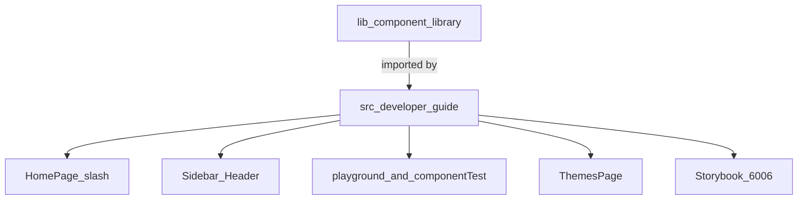
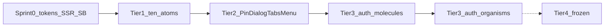
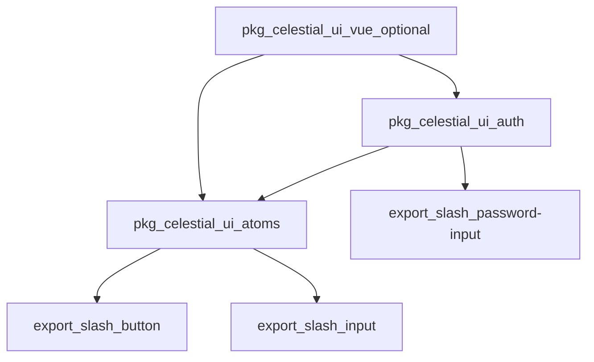

# Auth-first execution roadmap (`@celestial-ui/vue`)

**Decisions locked**

- **Modular npm (lodash-style), not one fat tarball.** Two layers:
  1. **Install a section** so `node_modules` stays small: `@celestial-ui/atoms` (Tiers 1–2), `@celestial-ui/auth` (Tier 3, depends on atoms). Optional umbrella `@celestial-ui/vue` depends on both for “install everything.”
  2. **Import one component** so the *app bundle* stays small: `import { CButton } from '@celestial-ui/atoms/button'` (like `lodash/get`). Each package `exports` map lists every component; `sideEffects: false` (CSS as exception).
- **Do not** publish 139 micro-packages (`@celestial-ui/button`, …). That is lodash’s old `lodash.get` model and is expensive to version. Sections + deep paths are enough.
- Source can stay under `lib/`; Sprint 0 adds a **pnpm workspace** (`packages/atoms`, later `packages/auth`) with real multi-entry Vite builds so those exports exist on disk. Auth app: `pnpm add @celestial-ui/atoms @celestial-ui/auth` — never forced to install templates/charts (frozen anyway).
- **The library itself is SSR-friendly (non-negotiable).** Target: Vue 3 SSR and Nuxt 3. Every public component must `import` in Node without throwing, `renderToString` without `window`/`document`, and hydrate with **identical markup** (no Vue hydration warnings). This is a **release gate** for `@celestial-ui/atoms` / `@celestial-ui/auth`, not an app-only concern. Rules: see “SSR and hydration” below.
- Auth is **UI + events only**. No login/OTP/tenant HTTP inside the library. The consuming app owns APIs.
- **Do not start Tiers 2–3** until the Sprint 0 gate and all ten Tier 1 atoms pass the checklist below.
- Follow existing folder contract ([`.cursor/rules/component-creation.mdc`](.cursor/rules/component-creation.mdc)) **inside `lib/`**: `C*.vue`, types, composable, CSS, Vitest, Storybook stories, `index.ts`, README (package-internal).
- **`lib/` vs `src/`:** `lib/` is the published component library. `src/` is the developer documentation app (home, sidebar catalog, playground demos, themes, Storybook entry). When this plan says “documentation,” it means **the full `src/` developer guide**, not only `lib/**/README.md`.

**Repo split**

---

## Sprint 0 — Shared gates (do this first, once)

These unblock every later component. No new atoms until this ships.

1. **Token source of truth** — Tokens already exist in [`lib/themes/base.css`](lib/themes/base.css) (`--cui-color-primary-*`, surface, text, border). Add semantic aliases the audit asked for (`--primary`, `--background`, `--surface`, `--border`, `--error`, `--radius`) pointing at those `--cui-*` values. Add a `[data-theme="dark"]` (or `.dark`) block **in CSS**, not JS hex.
2. **Stop writing hex from JS** — [`lib/plugins/theme.ts`](lib/plugins/theme.ts) currently sets `--cui-color-background-base` / `--cui-color-text-primary` as hex on `document.documentElement`. Change it to: toggle `data-theme`, **guard `typeof document`** (SSR), and let CSS own colors. [`lib/composables/useTheme.ts`](lib/composables/useTheme.ts) should not assume `window`.
3. **Icon network / SSR** — Replace `axios` in [`lib/components/atoms/icon/utils/svgLoader.ts`](lib/components/atoms/icon/utils/svgLoader.ts) with `fetch` + abort timeout; **no fetch on server** (return empty / skip; load in `onMounted`). Remove `axios` from [`package.json`](package.json) `dependencies`. Update [`lib/components/atoms/icon/__tests__/svgLoader.spec.ts`](lib/components/atoms/icon/__tests__/svgLoader.spec.ts).
4. **Public API honesty** — Export `CSwitch` + types from [`lib/components/atoms/index.ts`](lib/components/atoms/index.ts); set `ATOM_REGISTRY` Switch `implemented: true`. Stop auto-registering placeholder Toast in [`lib/index.ts`](lib/index.ts) (or register the ten real atoms only if `globalComponents` is true).
5. **Storybook actually loads library stories** — In [`.storybook/main.ts`](.storybook/main.ts) add `../lib/**/*.stories.ts`, register `@storybook/addon-a11y`, viewports 375 / 768 / 1440.
6. **A11y tests** — Replace mocked axe in [`lib/components/atoms/button/__tests__/CButton.a11y.spec.ts`](lib/components/atoms/button/__tests__/CButton.a11y.spec.ts) with `vitest-axe` (already a dep). Same pattern for other a11y specs as they are touched.
7. **Catalog freeze flags** — In [`src/data/components.ts`](src/data/components.ts) set Modal `implemented: false` until Tier 2. Do not add Chart/Calendar/etc. to any “implemented” list.
8. **Developer-guide shell (src)** — Restore [`src/pages/HomePage.vue`](src/pages/HomePage.vue) from the “Coming Soon” stub: list implemented components from `components.ts`, real counts, working Storybook button (port 6006). Confirm [`src/components/layout/Sidebar.vue`](src/components/layout/Sidebar.vue) nav matches catalog. [`src/pages/ComponentDocPage.vue`](src/pages/ComponentDocPage.vue) is a placeholder; either redirect `/components/:category/:componentName` to the playground route (`docPath`) or render the same usage + API content as playground pages—do not leave “docs will be available once implemented” for shipped components.

**Sprint 0 exit:** `pnpm test:unit` for icon + theme; Storybook lists CButton from `lib/`; no `axios` import in `lib/`; home `/` lists implemented atoms and opens Storybook.

---

## Definition of Done — library + developer guide (every modified or new component)

A component is not done until **`lib/` implementation** and the **`src/` developer guide** both match the new API.

### A. Library (`lib/`)

- Implementation, types, composable, CSS tokens.
- **Unit tests (mandatory, one suite per component):** `lib/components/<layer>/<name>/__tests__/C<Name>.spec.ts` using Vitest + Vue Test Utils. Cover: render/slots, props/variants, events (`update:modelValue`, click, complete, expire), disabled/loading/error, keyboard. **Plus** `C<Name>.a11y.spec.ts` (or a11y describe block) with **real** `vitest-axe` — no mocked axe that always returns zero violations. **Plus** SSR: `renderToString` does not throw and does not touch `document`/`fetch`.
- Must hydrate without Vue mismatch warnings (same markup server vs first client render).
- Storybook file: `lib/components/<layer>/<name>/stories/C<Name>.stories.ts` — default, variants/sizes, disabled, loading, error, empty, dark theme; 375 / 768 / 1440.
- Package-internal `README.md` in the component folder (component-creation rule). This is **not** a substitute for the `src/` guide.

Playground pages in `src/` are **demos**, not unit tests. Frozen backlog components get **no** new tests until they are unfrozen.

### B. Developer guide (`src/`) — this is “documentation”

Update **all** of these surfaces that already host usage, showcase, playground, and Storybook integration:

| Surface | Path / route | What to update |
| --- | --- | --- |
| Home / catalog | `/` — [`src/pages/HomePage.vue`](src/pages/HomePage.vue) | Implemented list, counts, Storybook CTA; stop using hardcoded `totalImplemented = 3` and the empty “Coming Soon” table |
| Nav | [`src/components/layout/Sidebar.vue`](src/components/layout/Sidebar.vue), [`Header.vue`](src/components/layout/Header.vue) | Links for new components; freeze items stay “coming soon” |
| Catalog data | [`src/data/components.ts`](src/data/components.ts) | `implemented`, `docPath`, `storybookPath`, props, examples |
| Playground index | `/playground` — [`src/pages/component-test.vue`](src/pages/component-test.vue) | Nav chips to each demo |
| Live demo + API tables | `/playground/atomic/...` (and later molecular/organism) — [`src/pages/componentTest/*.vue`](src/pages/componentTest/) + [`src/data/apiReference/`](src/data/apiReference/) + [`apiReference.vue`](src/components/Common/ApiReference/apiReference.vue) | Usage examples, props/events/slots/CSS vars, copy-paste Vue |
| Routes | [`src/router/testing.ts`](src/router/testing.ts), [`src/router/index.ts`](src/router/index.ts) | New playground routes; `/components/:category/:componentName` must not dead-end for shipped components ([`ComponentDocPage.vue`](src/pages/ComponentDocPage.vue) / [`PlaceholderPage.vue`](src/pages/PlaceholderPage.vue)) |
| Themes | `/themes` — [`src/pages/ThemesPage.vue`](src/pages/ThemesPage.vue) | If tokens/aliases change, show light/dark using CSS variables |
| Storybook | `.storybook` + homepage button | Library stories load; homepage “View Storybook” opens the SB app |

**Tier 1:** update existing playground pages, apiReference, catalog, home/sidebar, and stories so they show tokens, 44px, labels, ARIA — not old Tailwind blues or placeholder-as-label.

**Tiers 2–3:** add the full `src/` path **and** new `__tests__/C*.spec.ts` (+ a11y + SSR) for each new component. Frozen catalog names stay on [`PlaceholderPage`](src/pages/PlaceholderPage.vue) until unfrozen.

---

## Tier 1 — Remediate existing atoms (strict order)

Shared per-component bar (every file under `lib/components/atoms/<name>/styles/`):

- Colors: `var(--primary)` / `var(--cui-*)` only — strip Tailwind palette utilities (e.g. [`lib/components/atoms/button/styles/CButton.variants.css`](lib/components/atoms/button/styles/CButton.variants.css) `bg-blue-600`).
- Touch: interactive hit area **min 44×44px** on the default mobile size (drop or restyle `--xs` 24px in [`CButton.css`](lib/components/atoms/button/styles/CButton.css); same for Switch/Checkbox).
- Focus: `:focus-visible` rings; do not rely on `focus:outline-none` without a replacement ([`CButton.css`](lib/components/atoms/button/styles/CButton.css)).
- States: `aria-busy` when loading; `aria-invalid` + `role="alert"` error text with **icon + copy** (Input). `aria-disabled` when disabled.
- Tests: happy path, disabled/error, keyboard, **SSR `renderToString`**.
- SSR: no unguarded `document`/`window` in setup; Icon fetch only after mount.
- Stories + developer guide: apply the Definition of Done (`lib/` stories **and** `src/` home, catalog, playground, routes, apiReference, sidebar).

**Order (dependency + Auth usage):**

| Seq | Component      | Why this slot                                                                                        | Primary files                                                                                                                                     |
| --- | -------------- | ---------------------------------------------------------------------------------------------------- | ------------------------------------------------------------------------------------------------------------------------------------------------- |
| 1   | **Icon**       | Used by Button/Alert/Input; axios already in Sprint 0                                                | [`CIcon.vue`](lib/components/atoms/icon/CIcon.vue), [`CIcon.css`](lib/components/atoms/icon/styles/CIcon.css)                                     |
| 2   | **Button**     | Social login, dialog actions, wizard next                                                            | [`CButton.vue`](lib/components/atoms/button/CButton.vue), variants CSS                                                                            |
| 3   | **Input**      | Password, identifier; add optional `label` + `for`/`id` (no placeholder-as-label in default stories) | [`CInput.vue`](lib/components/atoms/input/CInput.vue), [`CInput.types.ts`](lib/components/atoms/input/CInput.types.ts) (`invalid` already exists) |
| 4   | **Checkbox**   | Consent, remember-me                                                                                 | checkbox styles + a11y spec                                                                                                                       |
| 5   | **Switch**     | Session/MFA toggles; already implemented, not exported                                               | [`CSwitch.vue`](lib/components/atoms/switch/CSwitch.vue) + Sprint 0 export                                                                        |
| 6   | **Avatar**     | Tenant/user chrome                                                                                   | avatar styles                                                                                                                                     |
| 7   | **Alert**      | Auth errors (icon + text, not color-only)                                                            | [`CAlert.vue`](lib/components/atoms/alert/CAlert.vue)                                                                                             |
| 8   | **Progress**   | MFA/wizard steps                                                                                     | progress styles                                                                                                                                   |
| 9   | **Card**       | Login layout card                                                                                    | [`CCard.vue`](lib/components/atoms/card/CCard.vue)                                                                                                |
| 10  | **Breadcrumb** | Settings/security paths                                                                              | breadcrumb styles                                                                                                                                 |

**Tier 1 exit:** All ten exported from atoms index; no `bg-blue-*` / `text-blue-*` in those CSS files; Input invalid state has `aria-invalid` and visible error with icon; **`/` and `/playground` plus each `/playground/atomic/<name>` page reflect the remediated API**; Storybook stories updated.

**Out of scope in Tier 1:** full ESM/CJS/`sideEffects` 1.0 packaging pass, `asChild`/NuxtLink polymorphism, splitting packages. Optionally add `sideEffects: false` with a CSS exception if it is a one-line `package.json` change; do not expand into a publish program.

---

## Tier 2 — Auth-blocker primitives (build after Tier 1 exit)

Same folder pattern. Register in [`lib/components/atoms/index.ts`](lib/components/atoms/index.ts) or molecules index as appropriate. Fix [`MOLECULE_REGISTRY`](lib/components/molecules/index.ts) (`CModal` false until Dialog exists).

**Build order:**

1. **`CDialog`** (library name for Dialog/Modal) — `role="dialog"`, `aria-modal`, `aria-labelledby`, focus trap, restore focus, `Escape` to close, teleport **client-only** (`onMounted` / `import.meta.client` guard). Replace [`lib/composables/useModal.ts`](lib/composables/useModal.ts) as a thin wrapper around dialog open state, not the UI. Controlled `v-model` + uncontrolled default.
2. **`CDropdownMenu`** — trigger + menu, keyboard (Arrow/Home/End/Escape), `aria-expanded` / `aria-controls`. Needed by `UserTenantDropdown`. (Catalog name `Menu` — implement as `CDropdownMenu` to match this roadmap.)
3. **`CTabs`** — roving tabindex, `aria-selected` / `aria-controls`. Needed by MFA/enrollment wizards.
4. **`CPinInput`** — length, paste/chunk OTP, `complete` emit, hidden label, 44px cells. Needed by OTP/device-code flows.

**Tier 2 exit:** Dialog, DropdownMenu, Tabs, PinInput each have `lib/` stories + tests, and a full `src/` developer-guide path (catalog, sidebar, playground route/page, apiReference, home listing). `/components/...` does not show Placeholder for these four.

---

## Tier 3 — Auth domain (UI events only)

Place under `lib/components/molecules/auth/` and `lib/components/organisms/auth/`. Export from [`lib/components/molecules/index.ts`](lib/components/molecules/index.ts) / [`organisms/index.ts`](lib/components/organisms/index.ts). **No axios/fetch.** Props in, events out (`submit`, `update:modelValue`, `select`, `complete`, `expire`, `cancel`).

**Molecules (order):**

1. **`CPasswordInput`** — compose `CInput` + show/hide toggle (`CButton`/`CIcon`); `aria-invalid` from parent.
2. **`CSocialLoginButton`** — compose `CButton` + `CIcon`; emit `click` with provider id.
3. **`CCountdownTimer`** — emit `expire`; `aria-live` polite; reduced motion.
4. **`CUserTenantDropdown`** — compose `CDropdownMenu` + `CAvatar`; emit `select` with **opaque ids passed in as props** (parent maps tenants).

**Organisms (order — Auth app lifecycle):**

1. **`CIdentifierFirstResolver`** — identifier field + continue; emit `resolve` with identifier string.
2. **`CAuthMethodDispatcher`** — present methods from **props** (`methods[]`); emit `selectMethod`.
3. **`CMfaChallengePanel`** — `CTabs` or stacked challenges + `CPinInput` / password slot; emit `complete` / `cancel`.
4. **`CQrSessionCanvas`** — render QR from **`src` or `value` prop** (parent fetches); `CDialog` optional; emit `expire` via timer.

Do **not** build in this phase: `PhoneInputWithCountry`, `DeviceCodeChunkedInput` (PinInput covers OTP), `SamlScimConfigurator`, `PolicySimulator`, `RolePermissionMatrix`, layout templates (`LoginLayout*`), etc.

**Tier 3 tests:** happy path (emit payload), empty/error props, keyboard. Skip “cross-tenant” network tests — isolation is the **app’s** job when it maps ids.

**Tier 3 developer guide:** Each molecule/organism is listed on home, in sidebar, on `/playground`, has a `componentTest` page with usage + event API tables, catalog/`storybookPath`, and Storybook stories. Recipes are copy-paste Vue **without** a backend.

---

## Tier 4 — Frozen backlog (do not build)

Explicit freeze until Auth app is unblocked:

- Heavy: Calendar, Chart, Graph, Sparkline, Heatmap, MarkdownEditor, CodeEditor, RichTextEditor, TreeView, FileExplorer, Kanban, Timeline, ColorPicker, VirtualList, VirtualTable, VideoPlayer, Carousel, Gallery.
- Layout kit: Box, Center, Flex, Grid, Stack, Spacer, AdminLayout, AppShell, DashboardLayout, etc. (demo [`src/components/layout/`](src/components/layout/) stays app chrome, not library).
- Remaining 139 names not in Tiers 1–3 (Select, DatePicker, DataTable, Toast/Notification until Auth needs them, etc.).
- Do not implement placeholder [`CToast.vue`](lib/components/molecules/toast/CToast.vue) as a “component.”

If a PR adds a frozen name, reject it unless Auth cannot ship without it.

---

## Suggested sprint calendar (single stream)

| Sprint | Scope                                                                           | Exit                       |
| ------ | ------------------------------------------------------------------------------- | -------------------------- |
| 0      | Tokens, theme SSR, fetch Icon, Switch export, Storybook glob, Modal catalog fix | Shared gates               |
| 1      | Icon, Button, Input, Checkbox                                                   | First four remediated      |
| 2      | Switch, Avatar, Alert, Progress, Card, Breadcrumb                               | **Tier 1 complete**        |
| 3      | CDialog, CDropdownMenu                                                          | Focus trap + menu a11y     |
| 4      | CTabs, CPinInput                                                                | **Tier 2 complete**        |
| 5      | Four Auth molecules                                                             | Events documented          |
| 6      | Four Auth organisms + playground recipes (copy-paste Vue, no backend)           | Auth UI pipeline unblocked |

---

## NPM layout: sections + lodash-style cherry-pick

**Why not a single `@celestial-ui/vue` only:** `npm install` of one package always downloads that package’s whole `dist`. Subpath imports (`/atoms`) shrink the *bundled app*, not the *install*. You asked for both: choose sections at install time, and choose components at import time.

| Developer wants | Install | Import |
| --- | --- | --- |
| One control | `@celestial-ui/atoms` | `from '@celestial-ui/atoms/button'` |
| Login UI only | `@celestial-ui/atoms` + `@celestial-ui/auth` | auth components (auth package lists atoms as peer/dependency) |
| Whole kit | `@celestial-ui/vue` | `from '@celestial-ui/vue'` or deep paths re-exported |

Sprint 0: workspace + `sideEffects`, per-component `exports`, CSS extracted per package. Today’s single `celestial-ui.es.js` build cannot deliver this.

---

## SSR and hydration — library product requirement

**Goal:** CelestialUI is a **universal Vue 3 library**. It must work in Nuxt 3, Vite SSR, and Node `renderToString` with **no hydration issues** as a default. The docs app (`src/`) is SPA today; that does not excuse `lib/` from being SSR-safe.

Modular install only reduces what you ship. Hydration still breaks when server HTML ≠ client HTML. Current gaps: [`lib/plugins/theme.ts`](lib/plugins/theme.ts) writes `document` in `install()`; Icon [`svgLoader`](lib/components/atoms/icon/utils/svgLoader.ts) can fetch during setup; future Dialog Teleport.

**Developer-guide (`src/`):** document SSR usage (set `data-theme` on `<html>` in the host Nuxt app; import CSS on server; do not wrap every component in `ClientOnly`). Add a short “SSR” note on Themes + each overlay component’s playground page.

**Hard rules for every component in Tiers 1–3**

1. **No `window` / `document` / `localStorage` / `matchMedia` in `setup()` or `install()` without a guard.** Use `typeof document !== 'undefined'` and apply DOM work in `onMounted` (or a Nuxt `ClientOnly` wrapper the *app* provides). Theme plugin: do not call `setTheme` → `document` on the server; set `data-theme` only on client **or** accept theme as a prop/cookie so SSR HTML already has the same class (preferred: host app sets `data-theme` on `<html>` before paint).
2. **First paint must be deterministic.** No `Math.random()`, `Date.now()`, `crypto.randomUUID()` in render. Use Vue `useId()` for input/label ids. CountdownTimer: SSR renders a stable initial remaining time from **props** (`expiresAt` or `remainingMs`); do not tick until `onMounted`.
3. **Async UI: same tree on server and hydrate.** Icon remote SVG: SSR and first client render show the same placeholder (or `img` src); load inline SVG only after mount. Do not `v-if="isLoading"` on server as false and on client as true in the same tick as hydrate — start `isLoading` false until mount if that changes DOM. Prefer `aria-busy` overlay that exists in both trees when `loading` is a **prop**.
4. **Teleport / Dialog / Dropdown:** Teleport to `body` is a classic mismatch. Use `<Teleport to="body" defer>` (Vue 3.5+) or render overlay **in place** on server and teleport only after mount. Focus trap and `document.addEventListener` only in `onMounted`; remove in `onBeforeUnmount`.
5. **CSS, not JS, for theme colors.** Light/dark via `[data-theme="dark"]` in CSS so markup does not depend on `window.matchMedia` during SSR. `mode: 'system'` must not read media on the server (default to `light` or to a value the host passed in).
6. **No top-level side effects** in ESM entry files (no `window.` at module scope). That also keeps Node SSR from crashing when importing `@celestial-ui/atoms/button`.

**Tests (required when touching SSR-sensitive code)**

- `renderToString` (Vue) then `mount` and assert no hydration warning (`data-allow-mismatch` is not a substitute).
- Icon: no `fetch` invoked during `renderToString`.
- Theme plugin `install` does not throw in jsdom-without-document mock / Node.

**What we will not do:** delay entire components behind `<ClientOnly>` as the default. That avoids mismatches but hurts SEO and CLS. Client-only is allowed only for Dialog overlay after open, QR canvas drawing, and clipboard paste on PinInput.

---

## What this roadmap does not include

- One npm package per component (139 publishes)
- Wiring SAML, passkeys, or session APIs
- Completing the frozen 139-name catalog (those names never get their own packages either)
